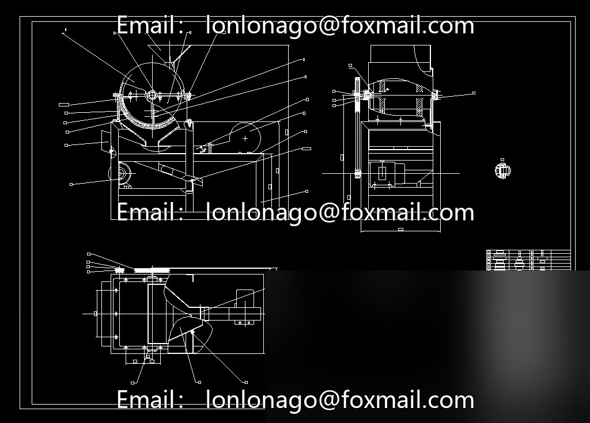
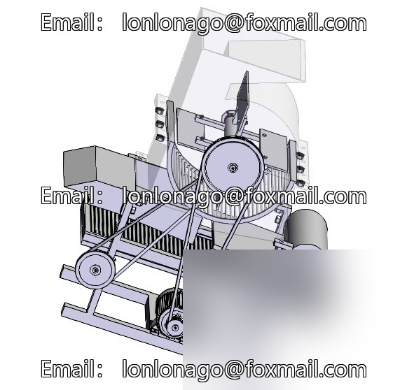
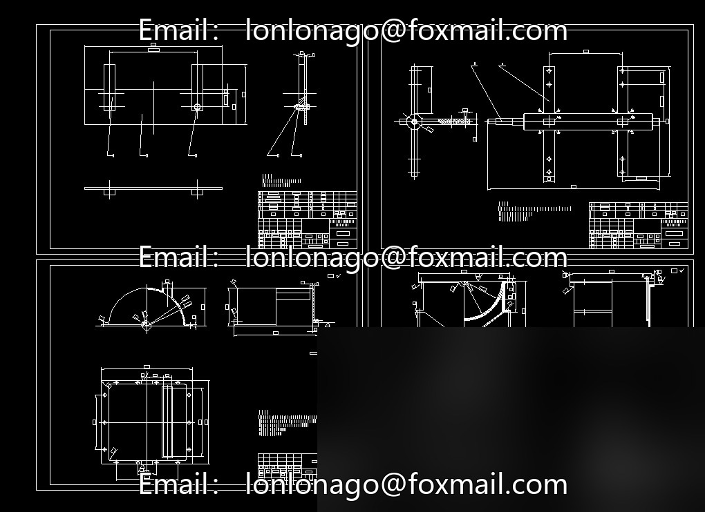

# Peanut shelling machine design drawing Peanut shelling machine CAD drawing Peanut shelling machine three-dimensional drawing Peanut shelling machine

## Body

Peanut sheller design drawing, peanut sheller CAD drawing, peanut sheller 3D drawing, peanut sheller 2D drawing, peanut sheller 3D model
Contains assembly drawing, part drawing, and 3D drawing and other types.
14

The design includes peanut shelling machine, CAD figures, 3D diagrams, 2D figures and 3D models, along with assembly drawings and part drawings.

<!-- AI_ENRICHED -->

## Images

## Payment

Here is a pay link on Stripe ( https://buy.stripe.com/3cs8yP7sY87d0vu9AB ). Please contact me lonlonago@foxmail.com after funding $89, and I will send you a complete data files , thank you!

